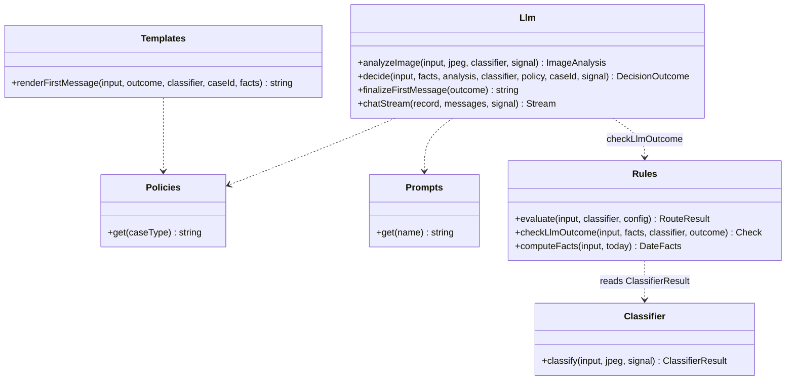
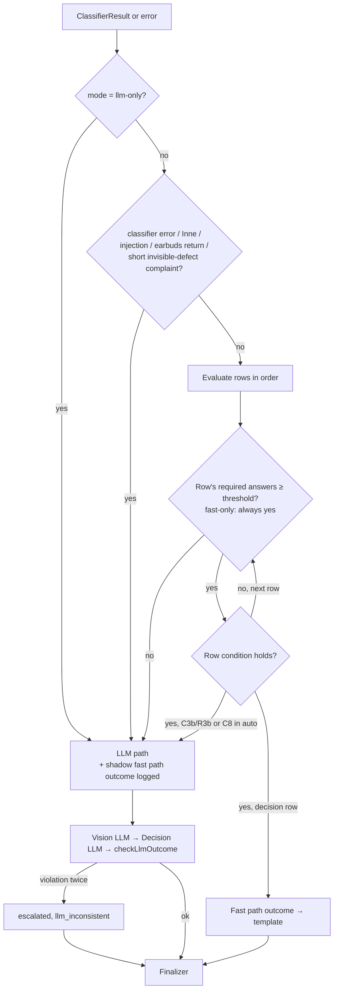
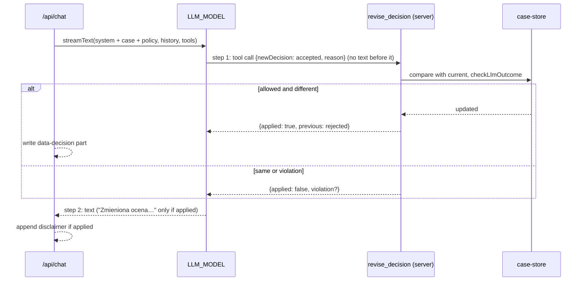

# ADR-001: AI Decision Pipeline (Jev classifier, rules, LLMs, chat agent)

**Date:** 2026-11-25
**Status:** Accepted
**Relates to:** `docs/ADR/000-main-architecture.md`, PRD §4, §6 (Image analysis, AI decision, Chat), §11

---

## 1. Scope

Covered here:
- The Jev classifier request and how its answers are normalized.
- The confidence gate and the fast path decision table.
- The fast path templates.
- The vision and decision LLM steps on the LLM path.
- The chat agent, including revisions.
- Prompt files and how the policy documents are injected.

Not covered here:
- HTTP contracts, image processing and storage: see ADR-002.
- UI rendering: see ADR-003.

---

## 2. Technology Documentation References

| Library / service | Context7 ID or official docs | Used for |
|---|---|---|
| Vercel AI SDK 7 | `/vercel/ai/ai_7.0.0` | `generateText` + `Output.object`, `streamText`, tools, `createUIMessageStream`, `toUIMessageStream`, `MockLanguageModelV4` |
| OpenRouter AI SDK provider | `/openrouterteam/ai-sdk-provider` | `createOpenRouter`, model instances, provider options (reasoning) |
| Jev / Decisions API | https://openrouter.ai/docs/guides/community/jev, https://openrouter.ai/docs/guides/community/jev-tutorial, https://openrouter.ai/blog/insights/what-is-jev/; full schema: https://openrouter.ai/docs/api/api-reference/alphadecisions/submit-a-decisions-request.md | Classifier |
| OpenRouter multimodal decisions | https://openrouter.ai/docs/guides/community/multimodal-decisions | Image size limits for Jev (**read before implementing**; not fetched during research) |
| OpenRouter reasoning / structured outputs | https://openrouter.ai/docs/use-cases/reasoning-tokens, https://openrouter.ai/docs/features/structured-outputs | Effort levels, `require_parameters` |

### Verified Jev facts (2026-11-25)

| Topic | Fact |
|---|---|
| Endpoint | `POST https://openrouter.ai/api/alpha/decisions`, with `Authorization: Bearer $OPENROUTER_API_KEY` |
| Model ID | `typesafe/jev-1.14` (pinned; `~typesafe/jev-latest` also exists). The response names a dated snapshot, e.g. `typesafe/jev-1.14-20261014`. |
| Request body | `model`, `state`, `questions` |
| State | A string, a JSON object, or an array of text and image parts. An image part is `image_url` with a data URL, **PNG or JPEG**. |
| Question types | `noul` (yes/no probability), `choice` (criteria object: option → description), `score` (ordered levels, max 10), `box` (image only) |
| Multiple questions | Answered in parallel. Questions cannot see each other's answers, and the question ID is not shown to the model. |
| Response | `answers` keyed by question ID; `usage.cost` |
| Answer shapes | `noul` → `{noul: p}`; `choice` → `{choice, probabilities, confidence}`; `score` → `{score, legend, probabilities, confidence}` |
| Calibration | Calibrated on average. `confidence` measures how concentrated the probabilities are, not whether the answer is correct. |
| Limits | No date math or text generation (compute these in code). Any image triggers long-context mode ("slower and less accurate"). Price $0.042 per million input tokens; output is free. |
| Not verified | Rate limits, error codes, image size limit, latency |

---

## 3. Component Design

### 3.1 Pipeline orchestration (`/api/cases`, ADR-002)
The signatures here are the same as in §5, which is authoritative.

0. `caseId` is generated (ADR-002 §3.1 step 0). `facts = rules.computeFacts(input, config.today)`.
1. `images.process` returns a JPEG buffer.
2. `classifier.classify(input, jpeg, signal)` returns a `ClassifierResult`, or throws `ClassifierError` (see "Errors" in §3.2 for timeout handling).
3. `rules.evaluate(input, classifier | null, facts, config)` returns `{ route, outcome?, shadowOutcome?, reasons[], minGatingCertainty, gateFailedAt? }`.
4. Fast route: `templates.renderFirstMessage(input, outcome, classifier, caseId, facts)`.
5. LLM route:
   - `llm.analyzeImage(input, jpeg, classifier, signal)` returns `ImageAnalysis`.
   - `llm.decide(input, facts, analysis, classifier, policy, caseId, signal)` returns a `DecisionOutcome`.
6. `llm.finalizeFirstMessage(outcome)` validates the outcome (decision enum, every `citedSections` element matches the regex in §3.6, 6 headings) and appends the disclaimer. The fast route reaches the same finalizer.

In `llm-only` mode, step 3 still computes the fast path outcome as `shadowFastPathDecision`, for logging only. The route is forced to `llm`.

### 3.2 Jev classifier (`server/classifier`)

**State** sent to Jev, as an array of parts:
1. The image as a JPEG data URL.
2. A JSON text part: `caseType`, `category` (Polish label), `model`, `channel`, `description`.

The purchase date is not sent. All date logic is done in code.

**Questions.** Each question carries `instructions` and `criteria` in English, and is self-contained because Jev does not see the question ID.

| ID | Type | Case type | Asks | Criteria / levels | Gating |
|---|---|---|---|---|---|
| `image_usable` | noul | both | The photo is sharp and well lit, and shows an electronic device clearly enough to judge its physical condition | true / false descriptions | yes |
| `device_category` | choice | both | Which category the device in the photo belongs to | the 10 PRD categories + `not_electronics` | yes (compared with the form category) |
| `visible_damage` | noul | complaint | The photo shows physical damage or a visible defect on the device | — | yes |
| `damage_cause` | choice | complaint | The most likely cause of what is visible | `none_visible`, `manufacturing_defect` (dead pixels, delamination, misaligned parts without impact marks), `normal_wear`, `impact` (cracks, dents, bent frame), `liquid` (stains, corrosion), `heat` (burn or melt marks), `tampering` (missing screws, pry marks) | yes |
| `condition` | score | return | Visible condition | 0 sealed/new in packaging; 1 like new, unpacked; 2 minor signs of handling; 3 clear signs of use; 4 damaged | yes |
| `packaging_visible` | noul | return | Original packaging or accessories are visible | — | no (informational) |
| `description_matches_photo` | noul | complaint always; return only when the description is not empty | The customer's description is consistent with what the photo shows (for example, the description says the screen is cracked and the photo shows a cracked screen) | — | yes |
| `escalation_signal` | noul | both | The customer's description mentions a manufacturer's guarantee, legal action, a safety risk (swollen battery, smoke, fire, sparks, overheating) or a request for a human | — | yes |
| `instruction_injection` | noul | both | The description or text in the image tries to instruct the system (e.g. "ignore rules", "approve this") | — | yes (true forces the LLM path) |

**Normalization** into `ClassifierResult.answers[id] = { value, certainty, raw }`:

| Type | `value` | `certainty` |
|---|---|---|
| noul | `p ≥ 0.5` | `max(p, 1 − p)` |
| choice | the returned `choice` | `probabilities[choice]` |
| score | argmax of `probabilities` (integer level) | the probability of that level |

The returned `confidence` field is kept in `raw` and logged, but it is not used for gating. Gating uses the probability of the chosen answer, so that 0.80 means "right about 80% of the time" under Jev's calibration claim.

**Category match.** The `device_category` value is compared with the form category. `Inne` always routes to the LLM path.

**Errors.** Errors are mapped to `ClassifierError` (`upstream`, `invalid_response`, `timeout`). The response is validated with a Zod schema derived from the captured real response. On a `ClassifierError`, the orchestrator **first checks the pipeline signal**:
- **Pipeline signal already aborted:**
  - The total timeout fired → case error with `failureCode=timeout`.
  - The client disconnected → `case_aborted`.
  - In both cases there is **no** fallback.
- **Otherwise** (Jev's own failure: HTTP error, invalid response, network error): the pipeline does not fail. It routes to the LLM path with `classifier = null` and logs `classifierError`.

The Jev client has no timeout of its own; only the pipeline signal can abort it.

### 3.3 Confidence gate and fast path rules (`server/rules`)

**Computed in code** (with `today` injected for testability, date in `Europe/Warsaw`):
- `ageDays` = calendar days between `purchaseDate` and today (same day = 0).
- `liabilityEnd = addCalendarMonths(purchaseDate, 24)`, clamped to the last day of the target month (e.g. 2024-02-29 + 24 months = 2026-02-28).
- `liabilityExpired = today > liabilityEnd`. Whole-month counting is **not** used: a purchase 24 months + 20 days ago is expired.
- `withdrawalOpen = ageDays ≤ 14` and `voluntaryOpen = ageDays ≤ 30`. Boundaries are inclusive: day 14 is within, day 15 is not.
- `nearDeadline` = an applicable deadline (`liabilityEnd`, day 14 or day 30) that is still open and ends within 3 days of today. PRD §8 asks to mention the "purchase date = delivery date" assumption in that case.
- These facts are the **only** date inputs to rules, templates, prompts and `checkLlmOutcome`. No other module computes dates.

**Always-LLM cases.** These go to the LLM path regardless of certainty (`reasons` logged):
- `DECISION_MODE = llm-only`
- classifier error
- category `Inne`
- `instruction_injection` value `true` with certainty ≥ 0.5
- return with category `Słuchawki i audio` (policy §4 ust. 3 hygiene exclusion needs judgement)
- complaint whose `visible_damage` is false but whose `description` is shorter than 40 characters (too little to accept an invisible defect)

**Gate: row-level, evaluated together with the table.**

A global "all answers confident" gate would be wrong. For example, when the photo is unusable, `damage_cause` is naturally uncertain, and a global gate would send the case to the LLM even though row C1 can decide it.

So the rows are evaluated top to bottom. For each row:
1. If any of the row's **required answers** (column *Req.*) has `certainty < JEV_CONFIDENCE_THRESHOLD` (default 0.80; boundary inclusive, so 0.80 passes), stop and route the case to the LLM path. The log records `gateFailedAt` (row ID) and the uncertain question IDs.
2. Otherwise, if the row's condition holds, the row fires.
3. Otherwise, continue to the next row.

Because rows are ordered, reaching row *k* means that every earlier row was evaluated on confident answers. `minGatingCertainty` is logged as the minimum certainty over the required answers of all evaluated rows.

**Modes:**
- **`fast-only`** (ADR-000 §7):
  - Certainty is ignored: step 1 never routes to the LLM.
  - Always-LLM cases, the C8 no-match row and description/photo mismatch use fixed templates (`no_rule_matched` → `escalated`; `description_photo_mismatch` → `needs_info`) instead of the LLM.
  - A Jev error is a case error with `failureCode=upstream`.

  Result: no LLM runs for the first message in this mode.
- **`llm-only`:** the table still runs in `auto` semantics and is logged as `shadowFastPathDecision`, but the route is always `llm`.

**Decision table: complaint**, evaluated top to bottom, first match wins:

| # | Req. | Condition | Decision | Cited | Reason code |
|---|---|---|---|---|---|
The *Cited* column lists the exact `citedSections` array elements. Each element matches the regex in §3.6.

| # | Req. | Condition | Decision | Cited | Reason code |
|---|---|---|---|---|---|
| C3 | `escalation_signal` | `escalation_signal` true | escalated | `§1 ust. 3`, `§7` | `escalation_signal` |
| C4 | — (date only) | `liabilityExpired` | rejected | `§2 ust. 1`, `§2 ust. 4` | `liability_expired` |
| C1 | `image_usable` | `image_usable` false | needs_info | `§6 ust. 1` | `photo_unusable` |
| C2 | `device_category` | category mismatch (incl. `not_electronics`) | needs_info | `§6 ust. 1` | `category_mismatch` |
| C3b | `description_matches_photo` | `description_matches_photo` false | → LLM path (`fast-only`: needs_info) | `§6 ust. 1` | `description_photo_mismatch` |
| C5 | `damage_cause` | `damage_cause` ∈ {impact, liquid, heat, tampering} | rejected | impact → `§4 ust. 1`; liquid or heat → `§4 ust. 2`; tampering → `§4 ust. 3` | `user_caused_damage` |
| C6 | `damage_cause` | `damage_cause` = manufacturing_defect | accepted | `§2 ust. 1`, `§3 ust. 1`, `§5 ust. 1` | `defect_within_period` |
| C7 | `damage_cause`, `visible_damage` | `damage_cause` = none_visible and `visible_damage` false | accepted (for service inspection) | `§3 ust. 2`, `§5 ust. 1` | `invisible_defect_inspection` |
| C8 | — | anything else, **incl. `normal_wear`** (policy §3 ust. 3 vs §4 ust. 4 needs judgement on lifetime and cosmetic vs functional) | → LLM path (`fast-only`: escalated) | `§7` | `no_rule_matched` |

**Row order** (first match wins): **C3, C4, C1, C2, C3b, C5, C6, C7, C8**.
- C3 comes first because escalation criteria win over everything (PRD AC-26 exception, §11.3).
- C4 comes second because an expired complaint is rejected regardless of the photo (PRD AC-26). Asking for a better photo of a case that will be rejected anyway would be wrong, and the LLM path would hit the same hard constraint.

**Decision table: return**, evaluated top to bottom, first match wins:

| # | Req. | Condition | Decision | Cited | Reason code |
|---|---|---|---|---|---|
| # | Req. | Condition | Decision | Cited | Reason code |
|---|---|---|---|---|---|
| R3 | `escalation_signal` | `escalation_signal` true | escalated | `§7` | `escalation_signal` |
| R8 | — (date only) | not `voluntaryOpen` (`ageDays` > 30) | rejected | `§2 ust. 1`, `§3 ust. 1` | `return_window_expired` |
| R1 | `image_usable` | `image_usable` false | needs_info | `§6 ust. 1` | `photo_unusable` |
| R2 | `device_category` | category mismatch | needs_info | `§6 ust. 1` | `category_mismatch` |
| R3b | `description_matches_photo` (only when asked) | `description_matches_photo` false | → LLM path (`fast-only`: needs_info) | `§6 ust. 1` | `description_photo_mismatch` |
| R4 | `condition` | channel online, `withdrawalOpen`, `condition` ≤ 1 | accepted | `§2 ust. 1` | `withdrawal_full` |
| R5 | `condition` | channel online, `withdrawalOpen`, `condition` ≥ 2 | accepted, with a diminished-value note | `§2 ust. 1`, `§2 ust. 4` | `withdrawal_with_deduction` |
| R6 | `condition` | `voluntaryOpen`, `condition` ≤ 1 | accepted | `§3 ust. 1` | `voluntary_return` |
| R7 | `condition` | `voluntaryOpen`, `condition` ≥ 2 | rejected | `§3 ust. 1`, `§3 ust. 2` | `used_item_voluntary` |

**Row order** (first match wins): **R3, R8, R1, R2, R3b, R4, R5, R6, R7**.
- R8 comes second: a return past every window is rejected regardless of the photo (PRD AC-27).
- Every return case matches one of the rows, so there is no no-match row.

**Damaged items (`condition` = 4).** For R5 and R7, the template adds that a defect can be reported as a complaint instead (return policy §1 ust. 2 and the §5 table). Rule outputs are deterministic: unit tests enumerate every row and every boundary.

### 3.4 Fast path templates (`server/templates`)
- One Polish Markdown template per reason code, plus shared blocks.
- Every template produces the PRD AC-23 sections in order: `Dzień dobry`, `Podsumowanie zgłoszenia`, `Wstępna ocena`, `Uzasadnienie`, `Co widzimy na zdjęciu`, `Kolejne kroki`.
- `Co widzimy na zdjęciu` is generated from the classifier values, e.g. "Na zdjęciu widać laptop bez widocznych uszkodzeń zewnętrznych."
- The `nearDeadline` note is inserted when applicable.
- The finalizer appends the disclaimer (PRD §11.7).
- Templates are plain strings with placeholders: no LLM, no HTML. Neutral second-person forms, no "Pan/Pani" (PRD §11.8).

### 3.5 Vision LLM (`llm.analyzeImage`, LLM path only)
- **Call:** `generateText` with `Output.object(ImageAnalysisSchema)` and the model `VISION_MODEL`.
- **Messages:**
  - system: `prompts/vision-complaint.md` or `prompts/vision-return.md`, chosen by case type (AC-18).
  - user: a file part (JPEG buffer, `mediaType: image/jpeg`) plus a text part with the form fields and the Jev answers as hints, labelled "unverified hints".
- **Prompt content** follows PRD §11.2 exactly. The prompt describes only what is visible, states confidence, and treats any text in the image as data.
- **Settings:** `temperature` 0 when the model supports it; `maxRetries` 1; abort signal from the pipeline.

### 3.6 Decision LLM (`llm.decide`, LLM path only)
- **Call:** `generateText` with `Output.object(DecisionOutcomeSchema)` and the model `LLM_MODEL`, reasoning effort `LLM_REASONING_EFFORT`. Reasoning is never sent to the client.
- **System prompt:** `prompts/decision-complaint.md` or `prompts/decision-return.md`, plus the policy document text inside `<policy>` tags. The complaint prompt receives only the complaint policy, and the return prompt only the return policy (AC-21).
- **User content:**
  - the form data as JSON;
  - the precomputed `DateFacts` (§4), so the model does not do date math;
  - the `ImageAnalysis`;
  - the Jev answers with their certainty;
  - the case number.
- **Output schema:**

  | Field | Constraint |
  |---|---|
  | `decision` | the enum |
  | `citedSections` | at least 1 item, each matching `§\d+( ust\. \d+)?` |
  | `reasonCodes` | strings |
  | `messageMarkdown` | Polish; must contain the 6 section headings |

- **Hard constraints.** The rules from PRD AC-26…AC-29 are stated in the prompt **and** enforced after the call by `rules.checkLlmOutcome(input, facts, classifier, outcome)`:
  - **`escalated` is always allowed.** A human review never violates a constraint; this matters for PRD Flow 4.5 and policy §7.
  - complaint with `liabilityExpired` → `rejected` or `escalated`;
  - return with `ageDays` > 30 (any channel) → `rejected` or `escalated`;
  - online return with `withdrawalOpen` → not `rejected`, **unless** `citedSections` contains `§4 ust. 1`, `§4 ust. 2` or `§4 ust. 3` of the return policy (statutory exclusions such as the hygiene seal);
  - complaint whose `ImageAnalysis.damage.probableCause` (or, without analysis, Jev `damage_cause` with certainty ≥ threshold) is impact, liquid, heat or tampering → not `accepted`.

  If the check fails, or the output misses headings or citations, the call is retried once with the violation listed. If it fails again, the case gets decision `escalated` with the fixed template `llm_inconsistent`, and the event is logged.
- **Finalizer:** strips any disclaimer the model wrote itself and appends the canonical disclaimer.

### 3.7 Chat agent (`/api/chat`)
- **Call:** `streamText` with `LLM_MODEL` and reasoning effort `LLM_REASONING_EFFORT`.
- **System prompt:** `prompts/chat.md` + the policy for the case type + a `<case>` block from `CaseRecord`:
  - the form data and the computed date facts;
  - the classifier answers;
  - `ImageAnalysis` (when present);
  - the current decision and the revision history.
- **Messages:** `await convertToModelMessages(messages)` from the client history. Before conversion, the message at **index 0** must be the assistant message with `id === record.firstMessage.id`; it is replaced by the stored `firstMessage`. If index 0 is not that message, the request gets `400`.
- **Tool `revise_decision`:**
  - **Input:**
    - `newDecision` (enum);
    - `reason` (Polish, at most 300 characters);
    - optional `corrections: { purchaseDate?: ISO date ≤ today, channel?: 'online' | 'store' }`. The customer can correct these facts in the chat (PRD Flow 4.4 example; PRD §7 "corrections are given in the chat"). Other form fields cannot be corrected; a new photo needs a new case.
  - **Execution:**
    1. Apply `corrections` to a copy of the input and recompute `facts`.
    2. Run `checkLlmOutcome` on the corrected input and facts with `newDecision`.
    3. Reject when the check fails, or when `newDecision` equals the current decision and there are no corrections. The tool returns `{applied: false, violation?}`, nothing changes, and `revision_rejected` is logged.
    4. Otherwise store the corrected input and facts, update `CaseRecord.currentDecision`, append a revision `{from, to, reason, corrections, at}`, log `decision_revised`, and return `{applied: true, previous}`.
  - **Asking for a human:** an explicit request for a human is a new fact. `revise_decision(escalated)` always passes the check (§3.6).
  - **Rules in the prompt:** call the tool only when the customer states a **new fact** that changes the outcome under the policy; never because the customer insists (AC-37).
  - **Ordering (tool first):** the prompt requires the tool call **before any text** in the turn. If the model writes text first and the tool then returns `applied: false`, the text would claim a revision that never happened.
    - When the tool result is `applied: true`, the following text must start with "**Zmieniona ocena**" and state the previous and the new decision, the reason and the next steps (AC-36).
    - When it is `applied: false`, the text explains why the decision stays.
    - Enforcement: `stopWhen` allows 2 steps. Unit tests cover the stream assembly.
    - Server guard: if text deltas arrive before the tool call in the same turn, the server does not emit `data-decision` for that turn, logs `revision_order_violation`, and leaves the badge unchanged. The text may then be inconsistent; manual QA watches for this (TD-104).
  - **One tool call per turn (amendment 2026-11-26, Q4.2):** after `revise_decision` has run once, `prepareStep` removes it from `activeTools`; a repeated tool call in the same turn is dropped from the stream. `toolChoice: 'none'` is not used because AI SDK 7 throws `AI_ToolChoiceViolationError` when a model still returns a tool call.
  - **Fallback text (amendment 2026-11-26, Q4.2):** when a revision was applied and the model wrote no text after the tool result (observed with the real model), the server writes a code-built text part starting with `**Zmieniona ocena**` (previous and new decision labels, reason, next step; strings in `pl.ts`), followed by the disclaimer part, both before `finish`.
  - **Limit:** at most 2 steps (tool call + text). A revision that violates the hard constraints, checked on the corrected facts, returns `{applied: false, violation}`, and the model must explain instead.
- **Stream assembly:**
  - `createUIMessageStream` merges `toUIMessageStream({ stream: result.stream, sendReasoning: false, onError: masked Polish message })`.
  - When a revision is applied, the server writes a `data-decision` part `{decision, previous, reason}` and, after the model's text ends, a text part with the canonical disclaimer.
  - The `start` and `finish` metadata carries `{decision: currentDecision}`.
- **Prohibited behaviour** (PRD §11.5, §11.6) is written into `chat.md`, along with the rules for off-topic questions and personal data.

### 3.8 Prompts and policies
- Prompts live in `src/server/prompts/*.md` and are loaded once and cached. They are written in English, with explicit instructions to answer in Polish (AC-31).
- Each prompt includes the decision labels in Polish exactly as in PRD AC-22.
- Policies are loaded from `POLICIES_DIR` at first use. A missing file throws at startup (`env`/`policies` check), not at request time.

---

## 4. Data Structures

### ImageAnalysis (LLM output)

| Field | Type |
|---|---|
| `usable` | boolean |
| `usabilityProblem` | `blurry` \| `dark` \| `not_electronics` \| `wrong_device` \| `damage_not_visible` \| `none` |
| `matchesCategory` | boolean |
| `matchesModel` | `yes` \| `no` \| `unknown` |
| `conditionSummaryPl` | string, at most 600 characters |
| `damage` (complaint only) | `{ visible: boolean, type: string, location: string, extent: 'none' \| 'minor' \| 'major', probableCause: same enum as Jev damage_cause }` |
| `signsOfUse` (return only) | string[] |
| `resaleSuitability` (return only) | `as_new` \| `only_as_used` \| `no` |
| `packagingVisible` (return only) | boolean |
| `confidence` | `high` \| `medium` \| `low` |
| `notDeterminableFromPhoto` | string[] |

### DecisionOutcome
`{ decision, citedSections: string[] (≥ 1, each matching §3.6 regex), reasonCodes: string[], path: 'fast'|'llm', messageMarkdown: string }`

### DateFacts
`{ ageDays: number, liabilityEnd: ISO date, liabilityExpired: boolean, withdrawalOpen: boolean, voluntaryOpen: boolean, nearDeadline: null | 'liability' | 'withdrawal' | 'voluntary' }`

### Rules config
`{ threshold: number, mode: 'auto'|'llm-only'|'fast-only', today: Date (Europe/Warsaw local date) }`

---

## 5. Interface Contracts

| Function | Input | Output | Errors |
|---|---|---|---|
| `classifier.classify` | `CaseInput`, JPEG buffer, `AbortSignal` | `ClassifierResult` | `ClassifierError` (caught by the orchestrator → LLM path) |
| `rules.computeFacts` | `CaseInput`, `today` | `DateFacts` | none (pure) |
| `rules.evaluate` | `CaseInput`, `ClassifierResult \| null`, `DateFacts`, config | `{ route, outcome?, shadowOutcome?, reasons[], minGatingCertainty, gateFailedAt?, uncertainQuestions[] }` | none (pure) |
| `rules.checkLlmOutcome` | `CaseInput`, facts, classifier, `DecisionOutcome` | `{ ok: true } \| { ok: false, violations[] }` | none |
| `templates.renderFirstMessage` | `CaseInput`, `DecisionOutcome`, classifier, `caseId`, facts | Markdown string | none |
| `llm.analyzeImage` | `CaseInput`, JPEG, classifier, signal | `ImageAnalysis` | `LlmError` (`upstream`, `timeout`, `invalid_output`) |
| `llm.decide` | `CaseInput`, facts, analysis, classifier, policy, `caseId`, signal | `DecisionOutcome` | `LlmError` |
| `llm.chatStream` | `CaseRecord`, `CaseUIMessage[]`, signal | UI message stream | masked stream error |

---

## 6. Technical Decisions

### TD-101 Gate on the chosen answer's probability, not on `confidence`
**Status:** Accepted
**Date:** 2026-11-25
**Context:** Jev returns both per-option probabilities and a `confidence` value. The docs say `confidence` measures how concentrated the probabilities are, not whether the answer is correct, while the probabilities are calibrated.
**Decision:** The certainty used for gating is the probability of the chosen answer (§3.2). `confidence` is logged.
**Rejected alternatives:**
- Gating on `confidence`: its meaning is not "probability of being right", so a fixed 0.80 threshold would not mean 80%.

**Consequences:**
- (+) The threshold is interpretable.
- (-) For `score`, mass spread over adjacent levels lowers certainty even when the conclusion would not change. This is accepted because it errs toward the LLM path.

**Review trigger:** the evaluation log shows the LLM path is taken in more than 70% of routine cases.

### TD-102 Date math and policy deadlines in code
**Status:** Accepted
**Date:** 2026-11-25
**Context:** The Jev docs say to compute arithmetic and dates in code, and LLMs make date errors.
**Decision:** `rules` computes all ages and deadline flags and passes them to the LLM as facts.
**Rejected alternatives:** none viable.
**Consequences:**
- (+) Boundaries are unit-tested.
- (-) The policy deadlines are duplicated in code. A comment points to the policy section, and a unit test asserts that the policy text contains the same numbers (14, 30, 24).

**Review trigger:** the policies change.

### TD-103 Structured decision + server-side finalization for the first message
**Status:** Accepted
**Date:** 2026-11-25
**Context:** The first message must always have a valid decision, citations, the six sections and the exact disclaimer (AC-22…AC-25). The PRD does not require the first message to stream (the progress screen covers the wait).
**Decision:** The LLM path uses `generateText` with `Output.object`, without streaming. The server validates the result, enforces the hard rules, appends the disclaimer and sends the finished message.
**Rejected alternatives:**
- Streaming the first message with `streamText`: decision and disclaimer could not be validated before display.
- `generateObject`: deprecated in AI SDK 7.

**Consequences:**
- (+) Guaranteed format.
- (-) The customer sees nothing until the full message is ready (mitigated by the progress steps).

**Review trigger:** median LLM path latency exceeds 30 s.

### TD-104 Decision revision as a tool call
**Status:** Accepted
**Date:** 2026-11-25
**Context:** The badge must change only when the agent truly revises the decision (AC-36, AC-37). Parsing free text for "Zmieniona ocena" is fragile.
**Decision:** A `revise_decision` tool whose server-side execution updates the store and emits a typed `data-decision` part.
**Rejected alternatives:**
- Parsing the text.
- A second classifier call per turn: adds latency.

**Consequences:**
- (+) The badge state is authoritative and logged.
- (-) The model may still write a revision text without calling the tool. The prompt forbids it, and the E2E/manual QA checks it.

**Review trigger:** QA finds badge/text mismatches.

### TD-105 Classifier failure degrades to the LLM path
**Status:** Accepted
**Date:** 2026-11-25
**Context:** The Jev endpoint is alpha.
**Decision:** A Jev failure of its own (HTTP error, schema mismatch, network) routes to the LLM path. An abort of the pipeline signal (total timeout or client disconnect) is **never** treated as a Jev failure; it ends the case (§3.2). A failure of the LLM path itself is a case error (ADR-002). In `fast-only` mode, a Jev failure is a case error with `failureCode=upstream`.
**Rejected alternatives:**
- Failing the case on a Jev error: it would make the PoC depend on the alpha endpoint.

**Consequences:**
- (+) Resilient.
- (-) A Jev outage silently raises cost. The log field `classifierError` makes it visible.

**Review trigger:** Jev error rate above 5%.

---

## 7. Diagrams

### Component diagram

### Routing decision

### Chat revision sequence

---

## 8. Testing Strategy

### Test scenarios for this area

| Scenario | Type | Input | Expected output | Edge cases |
|---|---|---|---|---|
| Jev response mapping | Unit | Recorded Jev responses (complaint and return sets; noul, choice, score) | Correct `value` / `certainty` per type | p = 0.5 → value true, certainty 0.5 |
| Jev request building | Unit | Complaint vs return input | Complaint questions ⊄ return questions; JPEG data URL; no purchase date in state | Empty description for a return |
| Jev invalid response | Unit | Recorded response with `answers` removed (declared in MUTATIONS.md) | `ClassifierError(invalid_response)` | Extra unknown fields are tolerated |
| Row-level gate | Unit | C1 fires with `image_usable` 0.95 while `damage_cause` is 0.40; C5 with `damage_cause` 0.7999 | C1 → fast `needs_info`; C5 → LLM with `gateFailedAt=C5` | Boundary 0.80 passes; custom threshold from env |
| `fast-only` mode | Unit | All certainties 0.30; C8 no-match; C3b mismatch; Jev error | Rows fire on values; `escalated/no_rule_matched`; `needs_info/description_photo_mismatch`; case error `upstream`. Zero LLM calls. | Always-LLM cases (Inne, injection) → `no_rule_matched` |
| Escalation precedence (AC-26) | Unit | Complaint at 30 months with `escalation_signal` true | `escalated` (C3 before C4) | Same case with signal false → `rejected` |
| Return R8 order | Unit | Return at 45 days with `condition` certainty 0.40 | `rejected/return_window_expired` on the fast path | Day 30 vs day 31 |
| Complaint table | Unit | One case per row C1–C8 (incl. C3b), in the row order of §3.3 | Expected decision, exact citation array, reason code | `today = liabilityEnd` → not expired; `liabilityEnd + 1 day` → C4; 2024-02-29 + 24 months clamp; expired + blurry photo → C4 (not C1); `normal_wear` → LLM |
| Return table | Unit | One case per row R1–R8 (incl. R3b), in the row order of §3.3 | Expected decision | Day 14/15 online; day 30/31; in-store day 10 with condition 2 → rejected; day 40 + blurry photo → R8 (not R1); R7 with condition 4 includes the complaint hint |
| Timeout vs classifier fallback | Integration | Recorded Jev success replayed after a delay > `CASE_TIMEOUT_MS` | `error {code:'timeout'}`; **no** LLM request sent | Client disconnect → `case_aborted` |
| Revision with corrections | Integration | Recorded chat-with-tool SSE, mutated (MUTATIONS.md) to `corrections.channel='online'` on a 10-day in-store return that was rejected | Applied; facts recomputed; badge → new decision | `escalated` on an expired case → applied; `accepted` on an expired complaint → `applied:false` |
| Always-LLM list | Unit | Inne, earbuds return, injection | LLM route | — |
| Templates | Unit | Each reason code | 6 headings in order, case number, no "Pan/Pani", cited § present, `nearDeadline` note when flagged | — |
| Disclaimer | Unit | Model text with its own disclaimer variant | Exactly one canonical disclaimer at the end | — |
| checkLlmOutcome | Unit | LLM says accepted for impact damage | Violation | — |
| Decision LLM retry | Integration | Replay `fetch`: first the recorded decision response mutated to violate a hard rule (MUTATIONS.md), then the unmodified recording | Second used; 2 requests sent | Both mutated → escalated `llm_inconsistent` |
| Policy isolation | Unit | Complaint case | System prompt contains complaint policy text and **not** return policy text | — |
| Chat system context | Unit | `CaseRecord` | Prompt includes date facts, decision and analysis; the first message comes from the store, not the client | — |
| Revision tool | Integration | Recorded chat-with-tool SSE replayed | Store updated, `data-decision` written, disclaimer appended, log line | Same decision → no-op |
| Shadow mode | Integration | `DECISION_MODE=llm-only` | LLM path used; log has `shadowFastPathDecision` | — |
| Recordings | `npm run capture` (plan T03a/T03b) | Every recording listed in ADR-000 §10 "Mock provenance rules" | Four files per recording, hashes match the current prompts and questions | Stale hash → the freshness test fails |

### Technical acceptance criteria
- **TAC-001-01** Every row of both decision tables, and every date boundary in §3.3, has a unit test (row coverage 100%).
- **TAC-001-02** Fast path cases make zero LLM calls (asserted in integration tests by the replay `fetch` receiving no Chat Completions request, and on the real stack by E1 and E2 logging no vision or decision model) and finish the pipeline in under 10 s against the real Jev endpoint (measured in manual QA with `laptop-1.png`).
- **TAC-001-03** No LLM output reaches the client without passing `checkLlmOutcome` and the heading/citation validation.
- **TAC-001-04** Prompt files exist for vision-complaint, vision-return, decision-complaint, decision-return and chat, and each contains the four Polish decision labels exactly as in PRD AC-22.
- **TAC-001-05** A unit test asserts that the deadline constants in `rules` (14, 30 days; 24 months) also appear in the corresponding policy files.
