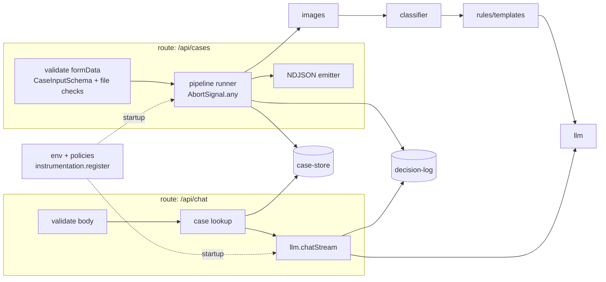
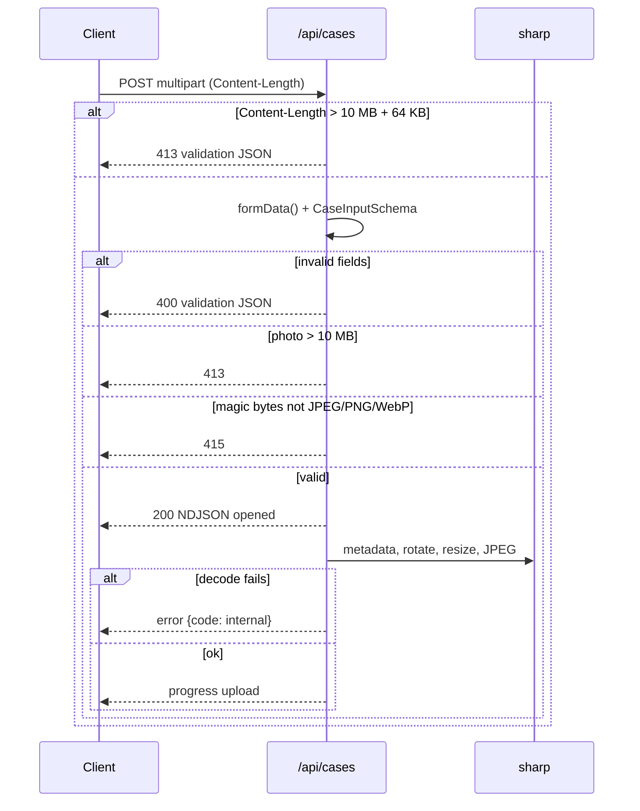
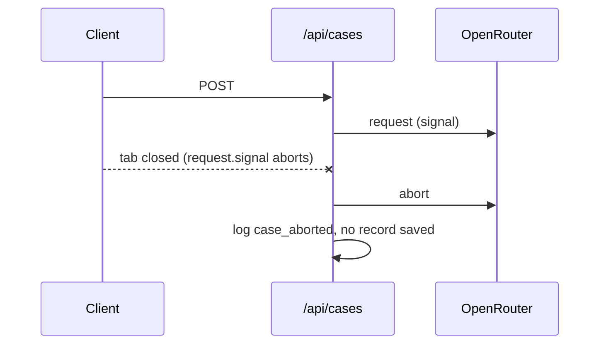

# ADR-002: Backend API, Image Processing, Case Store and Decision Log

**Date:** 2026-11-25
**Status:** Accepted
**Relates to:** `docs/ADR/000-main-architecture.md`, `docs/ADR/001-ai-decision-pipeline.md`, PRD §4.7, §6 (Form, Image analysis, Session, Errors)

---

## 1. Scope

Covered here:
- The `POST /api/cases` and `POST /api/chat` route handlers: their contracts, streaming formats and status codes.
- Server-side validation and image processing.
- The timeouts.
- The in-memory case store.
- The JSONL decision log.
- Env validation.

Not covered:
- Classifier, rules and prompts: see ADR-001.
- UI: see ADR-003.

---

## 2. Technology Documentation References

| Library | Context7 ID or official docs | Used for |
|---|---|---|
| Next.js 16 route handlers | `/vercel/next.js/v16.4.5` | `route.ts`, `request.formData()`, `runtime`, `maxDuration` |
| Vercel AI SDK 7 | `/vercel/ai/ai_7.0.0` | `createUIMessageStream`, `createUIMessageStreamResponse`, `consumeStream` |
| sharp | https://sharp.pixelplumbing.com/api-resize, https://sharp.pixelplumbing.com/api-output | Resize, rotate (EXIF), JPEG output, metadata |
| Zod 4 | https://zod.dev | Request and env schemas |

Verified notes (Context7, 2026-11-25):
- `runtime = 'nodejs'` is the default; `edge` is deprecated.
- `sharp` is on Next's default `serverExternalPackages` list.
- The 1 MB body limit applies to **Server Actions**, not to route handlers.
- A proxy (middleware) buffers at most 10 MB of body. This app has **no proxy**.
- A size limit for route handlers that use `formData()` is not documented, so TAC-002-04 tests it empirically.

---

## 3. Component Design

### 3.1 `POST /api/cases` (`src/app/api/cases/route.ts`)
Route segment config: `runtime = 'nodejs'`, `dynamic = 'force-dynamic'`, `maxDuration = 120`. The last one has no effect locally and documents intent.

Steps:
1. **Preflight.** If `Content-Length` exceeds 10 MB + 64 KB multipart overhead, respond `413` before reading the body.
2. **Parse.** Read `request.formData()`. Validate the fields with the shared `CaseInputSchema` (same schema as the client).
3. **File checks.** Exactly one `photo` file:
   - size > 10 × 1024 × 1024 bytes → `413`;
   - the **content** (magic bytes, confirmed by `sharp().metadata().format`) must be JPEG, PNG or WebP, otherwise `415`.

   The declared MIME type and the file extension are **ignored** for this decision. A mismatch is accepted when the content is valid, e.g. `assets/example-images/laptop-1.png` is JPEG content with a `.png` name.

   Validation failures return JSON `{ error: 'validation', fields: { [field]: polishMessage } }` with status `400`/`413`/`415`, and no stream.
4. **Stream.** Open an NDJSON response (`Content-Type: application/x-ndjson`, `Cache-Control: no-store`). Each line is one event (§4). Then run the pipeline under `AbortSignal.any([request.signal, AbortSignal.timeout(CASE_TIMEOUT_MS)])`:
   0. **Generate the `caseId` first.** Both the template and the decision LLM need it for the first message (PRD AC-41), so it must exist before any of them runs.
   1. `images.process` → emit `progress {step:'upload'}`.
   2. classifier, plus vision on the LLM path → emit `progress {step:'analysis'}`.
   3. rules/template or decision LLM → finalize → emit `progress {step:'decision'}`.
   4. Save the `CaseRecord`, log `case_decided`, emit `result`, close.
5. **Failure.** On any failure after streaming starts:
   - Log `case_failed` with `{step, failureCode}`, emit `error {code}`, close.
   - The codes are `timeout` (abort by timer), `upstream` (OpenRouter 4xx/5xx or network) and `internal`.
   - Raw errors go to the server log only (AC-47).
   - If the client disconnects (`request.signal` aborted), stop work, log `case_aborted`, save nothing and emit nothing.

**Case ID:** `HSD-` + local date `YYYYMMDD` (Europe/Warsaw) + `-` + 4 characters from `[A-Z0-9]`, generated with `crypto.randomInt`. Retry on collision in the store.

### 3.2 `POST /api/chat` (`src/app/api/chat/route.ts`)
Route segment config: `runtime = 'nodejs'`, `dynamic = 'force-dynamic'`, `maxDuration = 60`.

Steps:
1. **Validate the body** with Zod: `{ id: string, caseId: string, messages: CaseUIMessage[] }`.
   - 1–60 messages.
   - The last message is from the user and has a text part of 1–2000 characters after trimming.
   - Only `text` parts are accepted in user messages. File parts → `400` (AC-38).
2. **Look up the case.** `caseStore.get(caseId)`; missing or expired → `404 { error: 'case_not_found' }`. Each access refreshes the TTL.
3. **Stream.** Call `llm.chatStream(record, messages, request.signal)` (ADR-001 §3.7) and return `createUIMessageStreamResponse({ stream, consumeSseStream: consumeStream })`, so that aborts are handled.
4. **Errors.** `onError` returns the masked Polish text "Nie udało się wysłać odpowiedzi." (AC-46). The full error is written to the server log.

### 3.3 Image processing (`server/images`)
- **Input:** a `File` from `formData`, converted to a Buffer.
- **Steps:**
  1. Read `sharp(buffer).metadata()`. Reject when `format` is not `jpeg`, `png` or `webp`, or when decoding fails (`415`, "Dozwolone formaty: JPG, PNG, WEBP.").
  2. `rotate()` to apply EXIF orientation.
  3. Resize with fit `inside`, 2048 × 2048, `withoutEnlargement: true` (AC-17).
  4. Flatten transparency onto white.
  5. Re-encode as JPEG, quality 85, `mozjpeg` on.
  6. Strip metadata (EXIF/GPS are not kept).
- **Output:** `ProcessedImage`.
- **Why JPEG:** Jev accepts only PNG/JPEG, so one format for every model keeps the payload small and predictable.
- **Budget:** typical inputs process in under 1.5 s on the VM (manual QA measurement; not a hard test).
- **Storage:** the original and processed images are never written to disk and never logged.

### 3.4 Case store (`server/case-store`)
- A module-level singleton `Map<string, CaseRecord>`, stored on `globalThis` so it survives Next.js dev hot reload.
- **TTL:** 2 h since last access. Expired records are swept lazily on each `get`/`set`.
- **Size cap:** 500 records; the oldest by `lastAccess` is evicted.
- **Methods:** `create(record)`, `get(caseId)`, `update(caseId, fn)`, `size()`, `clear()` (tests only).
- **Contents:** only text data. No image bytes; the thumbnail stays in the browser.

### 3.5 Decision log (`server/decision-log`)
- `log(entry: DecisionLogEntry)` writes `JSON.stringify(entry)` to stdout and appends `entry + '\n'` to `DECISION_LOG_PATH`. It creates the folder if it is missing and uses async append.
- Errors are caught and reported on stderr; the request is never affected.
- An allowlist serializer copies only the fields defined in ADR-000 §5, so free text cannot leak (TAC-07).

### 3.6 Env (`server/env`)
- A Zod schema over `process.env`, parsed on first import.
- Defaults are listed in ADR-000 §7.
- `DECISION_MODE` is an enum; `JEV_CONFIDENCE_THRESHOLD` is a number in [0.5, 0.99].
- On failure it throws one error listing the missing or invalid variable names, never their values.
- `instrumentation.ts` (`register`) imports `env` and `policies`, so the server fails at startup and not on the first request (TAC-04).

### 3.7 OpenRouter HTTP client for Jev
- Uses plain `fetch` to `https://openrouter.ai/api/alpha/decisions` with the Bearer key, `Content-Type: application/json`, and the pipeline signal.
- Non-2xx responses: the status and at most the first 500 characters of the body go to the server log, and the client raises `ClassifierError('upstream')`.
- No retry, because the LLM path is the fallback (TD-105).

---

## 4. Data Structures

### NDJSON events from `/api/cases`

| `type` | Fields | When |
|---|---|---|
| `progress` | `step`: `upload` \| `analysis` \| `decision` | After each pipeline step completes; always in this order |
| `result` | `caseId`, `decision`, `firstMessage` (`CaseUIMessage`, role `assistant`, one text part with Markdown, `metadata.decision`), `caseSummary` (`caseType`, `category`, `model`, `purchaseDate`, `channel`) | Once, last line on success |
| `error` | `code`: `timeout` \| `upstream` \| `internal` | Once, last line on failure |

The internal path (`fast`/`llm`) is **not** sent to the client.

### Validation error body (`400`/`413`/`415`)
`{ error: 'validation', fields: Record<fieldName, polishMessage> }`. The messages are the same strings as PRD AC-04…AC-13.

### Chat request body
`{ id, caseId, messages }`. `caseId` is added by the transport (ADR-003).

### Chat stream data part
`data-decision`: `{ decision, previous, reason }`, non-transient (kept in message history).

---

## 5. Interface Contracts

| Endpoint | Status | Body | Meaning |
|---|---|---|---|
| `POST /api/cases` | 200 | NDJSON stream | Pipeline ran; the last event is `result` or `error` |
| | 400 | validation JSON | Invalid fields |
| | 413 | validation JSON (`photo`: "Plik przekracza limit 10 MB.") | File or body too large |
| | 415 | validation JSON (`photo`: "Dozwolone formaty: JPG, PNG, WEBP.") | Wrong format or undecodable |
| | 405 | — | Non-POST |
| `POST /api/chat` | 200 | UI message stream (SSE) | Reply streamed; stream errors are masked |
| | 400 | `{ error: 'invalid_request' }` | Schema violation, file parts, too long |
| | 404 | `{ error: 'case_not_found' }` | Unknown or expired case |

---

## 6. Technical Decisions

### TD-201 NDJSON progress stream for case submission
**Status:** Accepted
**Date:** 2026-11-25
**Context:** PRD §9.2 shows status lines "as steps complete". The pipeline takes several seconds (fast path) up to about 90 s (LLM path).
**Decision:** The route streams NDJSON events, which the client reads with `fetch` + `ReadableStream` + a line splitter.
**Rejected alternatives:**
- Timers that fake progress on the client: dishonest.
- SSE via `EventSource`: GET only, so no multipart upload.
- Polling with a job ID: needs a job store.
- Using `useChat` for submission: the first step is a form with a file, not a chat turn, and the PRD wants a progress screen before the chat.

**Consequences:**
- (+) Real progress.
- (+) One request.
- (-) A small custom stream parser on the client (unit tested).

**Review trigger:** jobs become asynchronous or persisted.

### TD-202 Re-encode every image to JPEG ≤ 2048 px with sharp
**Status:** Accepted
**Date:** 2026-11-25
**Context:** Inputs can be WebP, which Jev does not accept. The PRD asks for compression before the LLM (AC-17).
**Decision:** The sharp pipeline in §3.3.
**Rejected alternatives:**
- Client-side canvas resize: could be bypassed, and EXIF handling varies by browser.
- Keeping the original format: WebP would fail on Jev.

**Consequences:**
- (+) Predictable size (typically < 1 MB).
- (+) EXIF/GPS stripped (privacy).
- (-) Native dependency. sharp ships prebuilt binaries for linux-x64.

**Review trigger:** HEIC support is requested.

### TD-203 Separate total timeout per case, no per-model streaming timeouts
**Status:** Accepted
**Date:** 2026-11-25
**Context:** AC-30/AC-45 define one 90 s budget.
**Decision:** One `AbortSignal.timeout(CASE_TIMEOUT_MS)` combined with the request signal is passed to every step. The AI SDK `maxRetries` is 1 per LLM call. The chat uses no total timeout beyond the request; the client offers "Ponów".
**Rejected alternatives:**
- Per-step budgets: harder to reason about. The total is what the PRD measures.

**Consequences:**
- (+) Simple and matches the AC.
- (-) A slow Jev call eats into the LLM budget. Acceptable.

**Review trigger:** p95 LLM path latency exceeds 60 s.

---

## 7. Diagrams

### Component diagram

### Upload validation sequence

### Client disconnect

---

## 8. Testing Strategy

### Test scenarios for this area

| Scenario | Type | Input | Expected output | Edge cases |
|---|---|---|---|---|
| Valid complaint submission | Integration | Multipart with `laptop-1.png`, mocked Jev fixture (fast path) | 200; events `upload`, `analysis`, `decision`, `result` in order; record in store; one log line | — |
| Field validation | Integration | Missing `model`; 19-char complaint description; future date | 400 with the exact Polish messages | Return with an empty description → valid |
| Oversize | Integration | Generated non-photo payload of 10 MB + 1 byte (rejection-only exception from `assets/example-images/README.md`) | 413, before `formData()` is read | — |
| Wrong format | Integration | Generated non-image payload (plain text) named `fake.png` | 415 | — |
| Extension mismatch | Integration | Real `laptop-1.png` (JPEG content, `.png` name) | Accepted and processed as JPEG | — |
| Resize | Unit | **Real photos only:** `laptop-1.png` (3024 × 3135), `laptop-2.webp` (863 × 843), `phone-2.jpeg` (387 × 516) | Longer edge 2048 for `laptop-1`; small photos not upscaled; all outputs JPEG; output metadata has no EXIF block | If a real photo carries an EXIF orientation tag, assert that the output is upright; otherwise there is no rotation test (no generated images) |
| Timeout | Integration | Jev mock never resolves; `CASE_TIMEOUT_MS=200` | `error {code:'timeout'}` within 1 s | — |
| Upstream error | Integration | Jev 500, then vision mock throws | `error {code:'upstream'}`; error text has no provider or model name | — |
| Case ID | Unit | Fixed clock 2026-11-25 | Matches `^HSD-20261125-[A-Z0-9]{4}$` | Collision retry |
| Store TTL/cap | Unit | Fake timers; 501 inserts | Expired → undefined; oldest evicted | Access refreshes TTL |
| Chat 404 | Integration | Unknown caseId | 404 `case_not_found` | — |
| Chat input limits | Integration | 2001-char message; file part; 61 messages | 400 | Whitespace-only → 400 |
| Chat stream | Integration | `MockLanguageModelV4` with text chunks | SSE stream contains text parts and `metadata.decision` | Mock throws → masked Polish error |
| Log privacy | Integration | Description with a sentinel `ZZ-SENTINEL-ZZ` | Sentinel absent from the log file | — |
| Env | Unit | Missing `OPENROUTER_API_KEY` | Error names the variable, not its value | Invalid threshold 1.5 |

### Technical acceptance criteria
- **TAC-002-01** `/api/cases` emits progress events strictly in the order `upload` → `analysis` → `decision`, followed by exactly one terminal event.
- **TAC-002-02** No response body or stream event contains a stack trace, model ID, provider name or the substring `openrouter` (integration assertions on every error path).
- **TAC-002-03** Processed images have a longer edge ≤ 2048 px, are JPEG, and contain no EXIF block.
- **TAC-002-04** Through `npm start`, the largest real photo (`laptop-1.png`, about 1.2 MB) is processed, and a 10 MB + 1 byte generated payload gets 413 (E2E E8). That a real photo close to 10 MB is accepted is **not verifiable** with the provided photos. It is checked only if the owner supplies such a photo; otherwise the QA report records it as not verified.
- **TAC-002-05** Neither `request.formData()` nor sharp runs for requests whose `Content-Length` exceeds the preflight limit.
