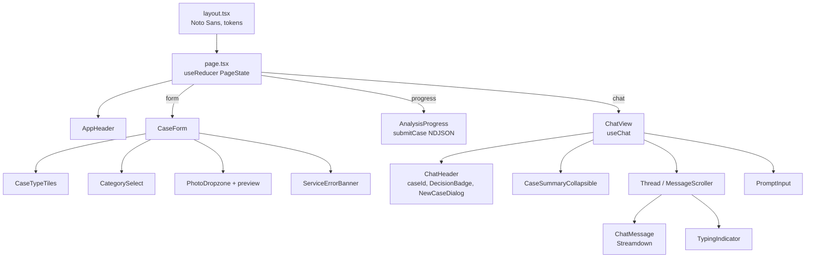
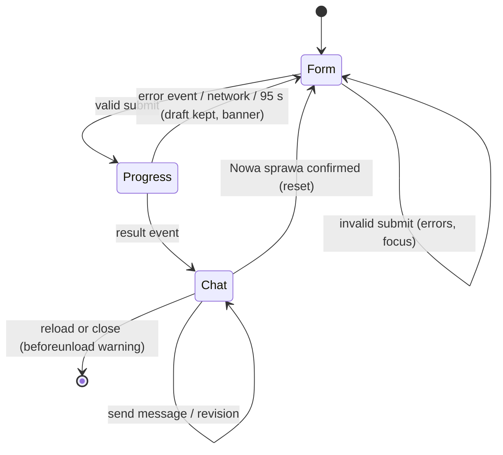
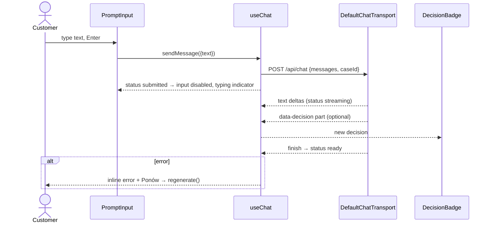

# ADR-003: Frontend — Page States, Form, Progress and Streaming Chat UI

**Date:** 2026-11-25
**Status:** Accepted
**Relates to:** `docs/ADR/000-main-architecture.md`, `docs/ADR/002-backend-api.md`, PRD §9, `docs/design-guidelines.md`

---

## 1. Scope

This ADR covers:
- The client side of the single page.
- The state machine.
- The form with validation and image preview.
- The progress screen that consumes NDJSON.
- The chat built on `useChat` with the AI Elements patterns and Streamdown.
- The decision badge.
- Leave-page protection.
- Styling from the design tokens.
- Accessibility.

It does not cover server behaviour (see ADR-001 and ADR-002).

---

## 2. Technology Documentation References

| Library | Context7 ID or official docs | Used for |
|---|---|---|
| `@ai-sdk/react` 4 (`useChat`) | `/vercel/ai/ai_7.0.0`, `/websites/ai-sdk_dev_ai-sdk-ui` | Chat state, `DefaultChatTransport`, `sendMessage`, `regenerate`, `status`, `dataPartSchemas` |
| shadcn/ui | `/shadcn-ui/ui/shadcn_4.21.0`, https://ui.shadcn.com/docs | Button, Card, Input, Textarea, Select, RadioGroup, Label, Badge, AlertDialog, Alert, Collapsible, Sonner (optional) |
| AI Elements (shadcn patterns) | https://ui.shadcn.com/docs/ai-elements (legacy reference: `/vercel/ai-elements`) | Chat thread / message scroller, Message, Prompt Input, shimmer |
| Streamdown | https://github.com/vercel/streamdown | Markdown rendering during streaming (AC-39) |
| react-hook-form + Zod resolver | https://react-hook-form.com, https://zod.dev | Form state and validation |
| Next.js fonts | `/vercel/next.js/v16.4.5` (`next/font/google`) | Noto Sans with the `latin-ext` subset |

**UNVERIFIED:** the exact registry names of the AI Elements patterns on ui.shadcn.com. During research the pattern pages returned 404 when fetched as `.md`. The implementing agent checks the current names on https://ui.shadcn.com/docs/ai-elements (or with `npx shadcn@latest search`) before adding them, and records them in `app/AGENTS.md`.

---

## 3. Component Design

### 3.1 Page state machine (`src/app/page.tsx`, client component)
`useReducer` with these states:
- `form`: holds `draft` (field values plus `File`) and an optional `serviceError`.
- `progress`: holds `draft` and `completedSteps`.
- `chat`: holds `caseId`, `caseSummary`, `thumbnailUrl`, `firstMessage` and `decision`.

Transitions:

| From | Event | To |
|---|---|---|
| form | submit (valid) | progress |
| progress | `result` | chat |
| progress | `error` or network failure or client timeout (95 s) | form (with `draft` kept and `serviceError` set) |
| chat | New case confirmed | form (empty; thumbnail object URL revoked) |

The draft, including the `File`, stays in memory, so a retry needs no re-entry (AC-45). Nothing goes to `localStorage`: refreshing gives an empty form (AC-42).

A header is rendered in all states. It shows a **text wordmark** "Hardware Service Decision Copilot" in navy, placed as described in design-guidelines → Logo placement. No image logo is used: the design guidelines state that the app needs its own logo and none is included.

### 3.2 Case form (`components/case-form/`)
- react-hook-form with `zodResolver(CaseInputClientSchema)`. This is the shared domain schema plus file rules:
  - type: the browser-reported `File.type` must be in {`image/jpeg`, `image/png`, `image/webp`}; when `File.type` is empty, the extension decides;
  - size ≤ 10 MB.

  The client check is a convenience only; the server decides by content (ADR-002 §3.1). For example, `laptop-1.png` reports `image/png` and is accepted by both.
- Mode `onTouched`: errors appear on blur or submit, which also satisfies AC-09 when switching to a complaint.
- **Fields**, in PRD order (AC-01):

  | Field | Control |
  |---|---|
  | Case type | Radio group styled as two tiles, with the subtitles from PRD §9.1 |
  | Category | shadcn `Select` with the 10 categories (no preselection) |
  | Model | `Input` |
  | Purchase date | Native `input type="date"` with `max` = today (local) |
  | Channel | `RadioGroup` |
  | Description | `Textarea` with an `N / 2000` counter |
  | Photo | Custom drop zone + hidden file input with `accept="image/jpeg,image/png,image/webp"` |

- **Case-type dependent texts:** the description label, the required marker / "(opcjonalnie)", the placeholder and the photo hint.
- **Photo preview:** an object URL thumbnail with file name, size and "Usuń". Selecting again replaces the file (AC-11, AC-14).
- **On invalid submit:** all errors shown, focus moved to the first invalid field (react-hook-form `shouldFocusError`), plus the summary "Popraw zaznaczone pola." (AC-15).
- **On valid submit:** the reducer moves to `progress` synchronously, before the request is sent (AC-16 within 1 s).
- **Service error banner** (`Alert`) at the top, with the PRD text and a "Spróbuj ponownie" button that resubmits the kept draft.
- **Server-side `400` field errors** are mapped back onto the fields with `setError`.

### 3.3 Progress screen (`components/progress/`)
- `submitCase(draft, signal)` posts `FormData` with `fetch`. It reads `response.body` through a `TextDecoderStream` and splits on newlines. Each line is parsed and validated with the shared Zod event schema and dispatched to the reducer.
- **Three status lines** ("Przesyłanie zdjęcia", "Analiza zdjęcia", "Przygotowanie oceny"):
  - pending: muted;
  - active: shimmer or spinner;
  - done: check icon.
- The screen also shows a read-only summary with the thumbnail. There is no cancel button.
- **Client safety timeout:** 95 s, via `AbortController`, then back to the form with the banner.

### 3.4 Chat (`components/chat/`)
- **`useChat<CaseUIMessage>`:**
  - `id: caseId`
  - `messages: [firstMessage]`
  - `transport: new DefaultChatTransport({ api: '/api/chat', body: () => ({ caseId }) })`
  - `dataPartSchemas: { decision: DecisionDataSchema }`
- **Header bar:**
  - case number;
  - case type;
  - `DecisionBadge`: a label + icon per decision (check / x / help-circle / user-arrow), so the decision is never shown by color alone;
  - "Nowa sprawa".

  The badge value comes from the latest `data-decision` part, or else the latest `metadata.decision`, or else `firstMessage.metadata.decision`.
- **Case summary:** a `Collapsible` with the form data and thumbnail. It is collapsed by default below 768 px (CSS media query plus initial state from `matchMedia`).
- **Message list:** the AI Elements thread / message scroller. It sticks to the bottom only while the user is at the bottom; a "scroll to latest" button appears otherwise (AC-40).
  - Assistant messages are left-aligned; their text parts render through Streamdown, with raw HTML disabled.
  - User messages are right-aligned, as plain text with preserved line breaks.
  - A message whose `data-decision` part exists gets a visible "Zmieniona ocena" label chip above the bubble. The disclaimer paragraph is styled muted but keeps normal contrast (≥ 4.5:1).
- **Typing indicator:** shown while `status` is `submitted`, or `streaming` with no text yet.
- **Input** (AI Elements Prompt Input):
  - Textarea with Enter = send and Shift+Enter = newline. IME composition is respected (no send while `isComposing`).
  - Send is disabled when the trimmed text is empty or `status !== 'ready'` (AC-33, AC-34).
  - Counter shown from 1800 characters; `maxLength` 2000.
  - Attachments are not rendered (AC-38).
- **Errors:**
  - When `status === 'error'`, an inline error is shown under the last user message ("Nie udało się wysłać odpowiedzi.") with "Ponów", which calls `regenerate()`. The user message is not re-added (AC-46).
  - On HTTP 404 (PRD AC-52), the text is "Sprawa wygasła. Rozpocznij nową sprawę." with the New case action, and the input is disabled.
    - Detection: pass a `fetch` wrapper to `DefaultChatTransport`. The wrapper calls the real `fetch` and, on status 404 with body `case_not_found`, sets a `caseExpired` flag in component state before returning the response. The UI branches on that flag, not on parsing `error.message`.
    - **Verify** that the transport's `fetch` option exists in `/vercel/ai/ai_7.0.0` before implementing. If it does not, use `prepareSendMessagesRequest` plus a pre-flight `HEAD /api/chat?caseId=` and record the choice here.
- **New case:** an `AlertDialog` with the PRD text (Flow 4.6). On confirm, the reducer resets to `form`.
- **Leave-page protection:** a `beforeunload` listener is registered only while the state is `chat` (AC-43).

### 3.5 Styling and brand
- **Tokens:** `assets/design-tokens.json` is mapped to the shadcn CSS variables in `globals.css`:
  - `--primary` ← navy `#003963`
  - `--ring` and `--accent` ← `#0096E0`
  - `--border` ← `#85D2F1`
  - `--destructive` ← magenta `#CC1D56`
  - `--muted` ← `#E9F4FD`
  - text colors from `text.*`

  Radii and spacing also follow `docs/design-guidelines.md`. Light theme only.
- **Font:** `next/font/google` `Noto_Sans` with subsets `latin` and `latin-ext` (needed for Polish ą, ę, ł, ś, ż), weights 400/500/700. The files in `assets/fonts/` are a Latin-only subset, and the design guidelines raise a license question about them, so they are not used.
- **Decision badge colors:**

  | Decision | Color |
  |---|---|
  | accepted | success `#208A20` |
  | rejected | magenta |
  | needs_info | accent blue |
  | escalated | navy outline |

  Icon and label are always present.
- **Responsive:** 360–1920 px with no horizontal scroll (AC-49). The form max width is about 720 px and the chat column about 840 px.
- **Language:** all strings are Polish and live in `src/lib/i18n/pl.ts` (one module, no i18n framework), so tests and UI share them (AC-48).

### 3.6 Accessibility
- Every control has a visible `<label>`. Error text is linked with `aria-describedby`, and invalid fields have `aria-invalid`.
- The progress steps use `aria-live="polite"`. The message list uses `role="log"` with `aria-live="polite"`.
- The decision badge has an accessible name, e.g. "Decyzja: Wstępnie zaakceptowano".
- The keyboard alone can complete the whole flow (AC-50), including the drop zone (Enter/Space opens the file dialog) and the dialog focus trap.

---

## 4. Data Structures
- `Draft`: `{ caseType?, category?, model, purchaseDate, channel?, description, photo?: File }`
- `PageState`: discriminated union `form | progress | chat` (§3.1)
- `CaseEvent`: Zod union of the NDJSON events (ADR-002 §4), shared with the server
- `CaseUIMessage`: `UIMessage<{ decision?: Decision; revised?: boolean }, { decision: { decision, previous, reason } }>`
- `DecisionLabel` map: enum → `{ label (PL), icon, tone }`

---

## 5. Interface Contracts

| Consumer | Contract | Notes |
|---|---|---|
| `submitCase(draft, signal)` | `POST /api/cases` multipart → `AsyncIterable<CaseEvent>`, or `ValidationError` for 400/413/415 | Parser tolerates chunk boundaries mid-line |
| `useChat` transport | `POST /api/chat` `{ id, messages, caseId }` → UI message stream | `caseId` is added through the transport `body` function |
| `DecisionBadge` | props `{ decision }` | Pure |
| `ChatMessage` | props `{ message: CaseUIMessage }` | Renders text parts via Streamdown; ignores reasoning and unknown parts |

---

## 6. Technical Decisions

### TD-301 `useChat` seeded with the first message, not used for submission
**Status:** Accepted
**Date:** 2026-11-25
**Context:** The first assistant message comes from `/api/cases`, and only later turns are a chat.
**Decision:** After `result`, mount `ChatView` with `useChat({ id: caseId, messages: [firstMessage] })`. All follow-up turns go through `sendMessage({ text })`.
**Rejected alternatives:**
- Sending the form as the first `useChat` message with file parts. This mixes form validation into chat, puts the image in the client history (resent with every turn) and removes the progress screen.

**Consequences:**
- (+) Clean separation.
- (+) The image is sent once.
- (-) Two client data paths (NDJSON and the UI message stream).

**Review trigger:** the PRD adds image upload inside the chat.

### TD-302 Native date input instead of a calendar component
**Status:** Accepted
**Date:** 2026-11-25
**Context:** The PRD asks for a date picker with max = today and keyboard operability.
**Decision:** `input type="date"`. Browsers show a localized picker, and `max` is enforced, with validation repeated in Zod.
**Rejected alternatives:**
- shadcn Calendar (react-day-picker): extra dependency and focus management, for no PoC benefit.

**Consequences:**
- (+) Accessible by default.
- (-) The look differs slightly per browser.

**Review trigger:** brand QA rejects the native look.

### TD-303 Streamdown for agent messages
**Status:** Accepted
**Date:** 2026-11-25
**Context:** Messages stream with partial Markdown (headings, lists, bold).
**Decision:** Streamdown with raw HTML disabled, plus the Tailwind `@source` entry its docs require.
**Rejected alternatives:**
- react-markdown: shows broken syntax mid-stream.

**Consequences:**
- (+) Clean rendering mid-stream (AC-39).
- (-) One more dependency.

**Review trigger:** none expected.

---

## 7. Diagrams

### Component tree

### Page state diagram

### Chat turn (client view)

---

## 8. Testing Strategy

### Test scenarios for this area

| Scenario | Type | Input | Expected output | Edge cases |
|---|---|---|---|---|
| Form field order and options | Unit (RTL) | Render | 7 fields in PRD order; 2 case types, 10 categories, 2 channels, none preselected | — |
| Validation messages | Unit | Each invalid input from AC-04…AC-13 | Exact Polish messages; focus on first invalid | AC-09 switch without blur → no error |
| Photo handling | Unit | Select a 2nd file; `.gif`; 11 MB | Replaced; format error; size error | Remove clears |
| NDJSON parser | Unit | Chunks split mid-line, invalid JSON line | Events in order; invalid → error event | Empty trailing line |
| Reducer | Unit | All transitions in §3.1 | Correct states; draft kept on error | Revoke object URL on reset |
| Badge source | Unit | Messages with metadata only, then with a `data-decision` part | Badge shows the latest decision | — |
| Chat input | Unit | Whitespace; 2001 chars; Shift+Enter; IME composing | Disabled; capped; newline; no send | — |
| Chat retry | Unit (mocked `useChat`) | `status=error` | Inline error, Ponów calls `regenerate` | — |
| beforeunload | Unit | State chat vs form | Listener present only in chat | — |
| E2E happy paths | E2E (real) | See ADR-000 §10 | — | — |
| Manual QA | Playwright CLI | Every screen at 360 px and 1920 px | Screenshots compared with `assets/homepage.png` tokens; Polish text; no console errors | Keyboard-only run |

### Technical acceptance criteria
- **TAC-003-01** No `localStorage`/`sessionStorage` usage for case data (grep check + reload E2E shows the empty form).
- **TAC-003-02** `@axe-core/playwright` reports 0 `serious` and 0 `critical` violations on the form, progress and chat screens (E2E E10).
- **TAC-003-03** At 360 px width, `document.documentElement.scrollWidth <= 360` on all three screens.
- **TAC-003-04** All UI strings come from `src/lib/i18n/pl.ts`; a unit test ensures every PRD UI string from AC-04…AC-52 exists there verbatim.
- **TAC-003-05** The browser console shows zero errors and zero React warnings during the E2E suite.
